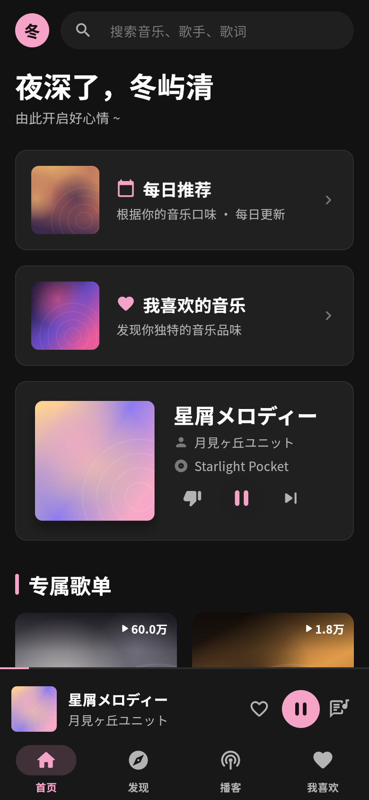
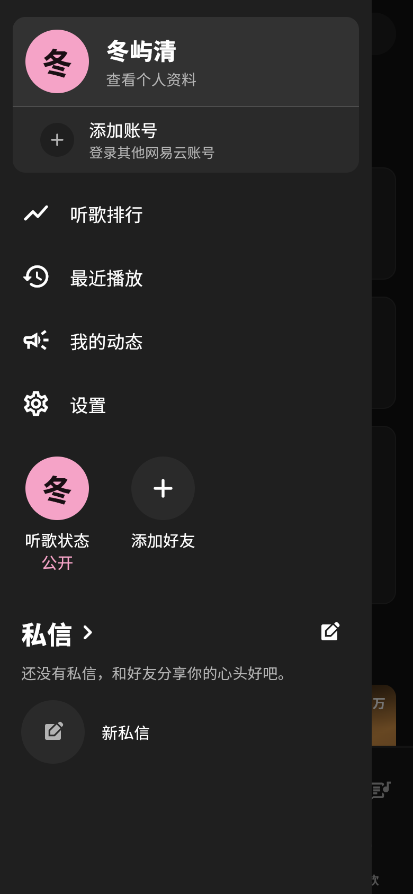
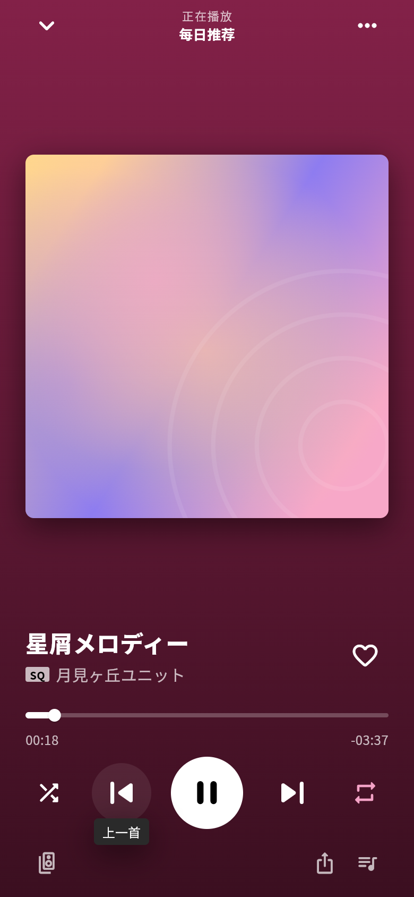
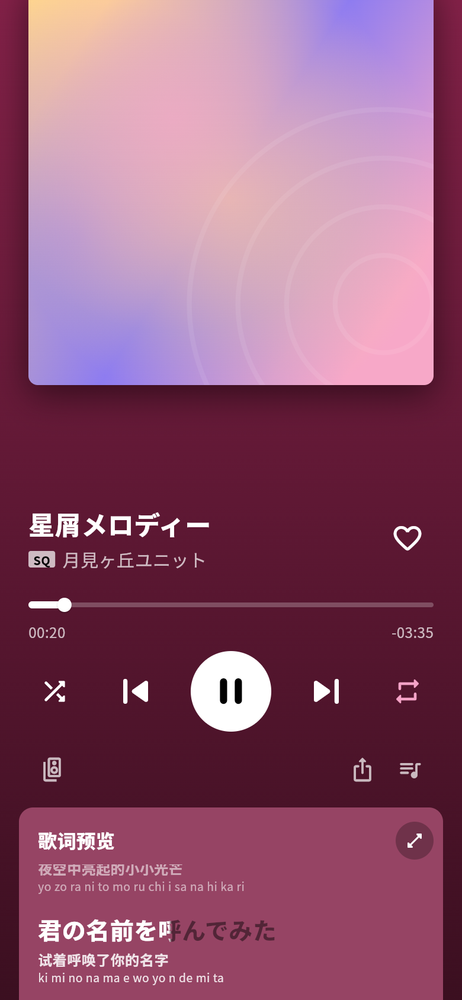
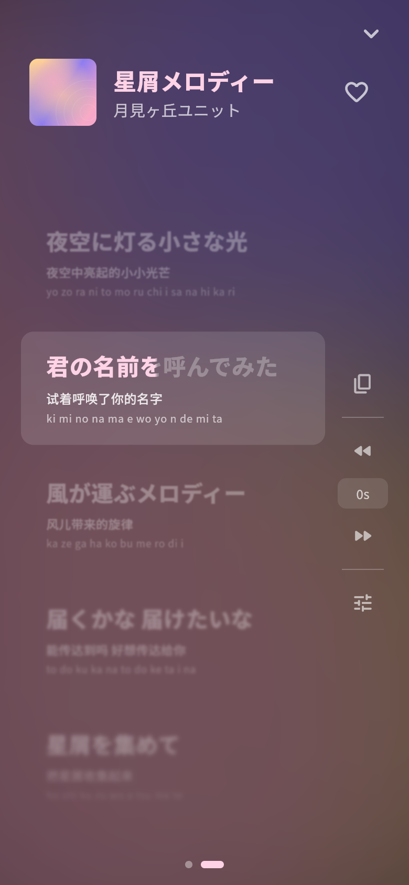

# Netease-client
### ⚠️这个项目目前处于开发阶段，可能会遇到各种不稳定的情况⚠️
一个基于flutter开发的网易云音乐第三方客户端
小项目，不喜勿喷，有问题欢迎在issue指出

> 当前阶段：纯前端预览，全部数据为假数据，尚未接入任何 API 和音频播放。目前只做手机端（Android + iOS）。

| 首页 | 抽屉侧栏 | 播放页 | 播放页下滑 | 全屏歌词 |
| --- | --- | --- | --- | --- |
|  |  |  |  |  |

## 运行

需要 Flutter 3.47+（Dart 3.13+）。

```bash
flutter pub get
flutter run              # 连接 Android / iOS 设备或模拟器
```

预览启动后会自动"播放"一首假歌。点左上角头像打开抽屉侧栏，点底部迷你播放条进入播放页，点歌词按钮直接打开全屏歌词。
`web/` 目录只用于在浏览器里快速预览，不是发布目标。

## 设计

- 手机端布局：顶栏（头像 + 搜索）+ 内容 + 迷你播放条 + 底部导航；点头像从左侧滑出抽屉侧栏（个人资料、听歌排行、最近播放、动态、设置、私信）。
- 暗色、无彩界面，颜色交给封面；唯一强调色是樱花粉 `#F5A3C7`，只用在选中、喜欢、进度等功能性位置。
- 播放页：背景是封面主色的纯色渐变；第一屏是大封面、歌名/喜欢、进度、控制；往下滑是歌词预览卡片和歌手卡片。
- 全屏歌词：封面主色做底，已唱的行偏白、未唱的行压暗，当前行逐字填色，附翻译和罗马音；当前行自动滚动，手动滚动后暂停跟随 3 秒；「更多」里可调歌词偏移。

## 目录

```
lib/
  app/        应用入口、显示名
  theme/      颜色、圆角、阴影、ThemeData
  data/       模型、格式化工具、假数据（mock_data.dart 接 API 后删除）
  state/      PlayerController（假播放器，接口按真实播放器设计）
  shell/      主框架：顶栏、抽屉侧栏、迷你播放条、底部导航
  pages/      首页、播放页、全屏歌词
  widgets/    通用组件（占位封面、主色提取、悬停、圆形按钮）
```

## 检查

```bash
flutter analyze
flutter test
```
