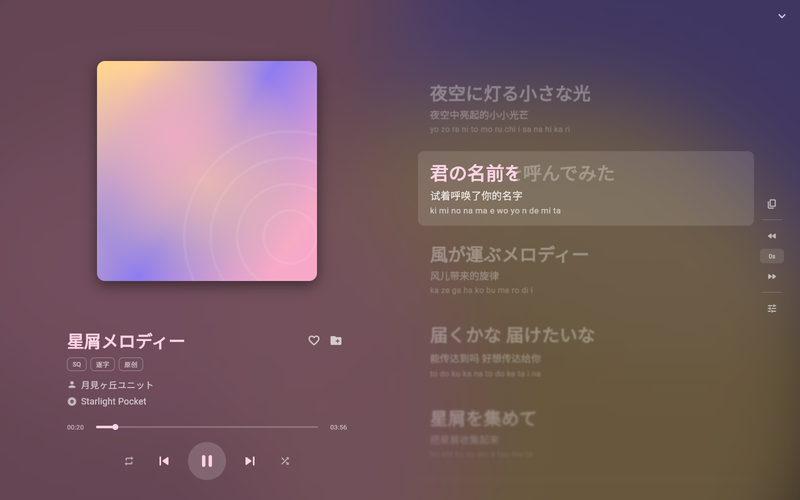
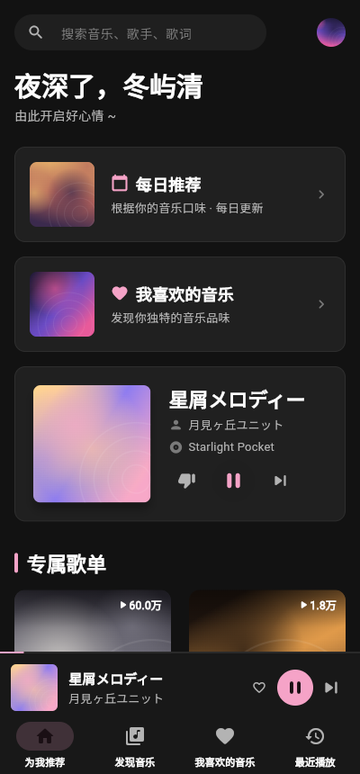

# Netease-client

A third-party NeteaseMusic client developed using Flutter.

> 当前阶段：纯前端预览，全部数据为假数据，尚未接入任何 API 和音频播放。


| 播放页（宽屏分栏） | 歌词（窄屏） | 手机布局 |
| --- | --- | --- |
|  |  |  |

## 运行

需要 Flutter 3.47+（Dart 3.13+）。

```bash
flutter pub get
flutter run -d windows   # 或 macos / linux / chrome
```

预览启动后会自动"播放"一首假歌，点底部播放条的封面进入播放页，点「词」按钮直接打开歌词。
播放页里 `Esc` 收起，`Space` 播放/暂停。

## 设计

- 桌面优先：侧边栏 + 顶栏 + 内容区 + 底部播放条；宽度 < 840 时切换成手机布局（底部导航 + 迷你播放条）。
- 暗色、无彩界面，颜色交给封面；唯一强调色是樱花粉 `#F5A3C7`，只用在播放、选中、进度等功能性位置。
- 播放页背景从封面取色并模糊漂移；宽度 ≥ 1000 时封面与歌词左右分栏，否则左右滑动切换。
- 歌词支持逐字填色、翻译、罗马音、偏移调整，当前行自动滚动，手动滚动后暂停跟随 3 秒。

## 目录

```
lib/
  app/        应用入口、显示名
  theme/      颜色、圆角、阴影、ThemeData
  data/       模型、格式化工具、假数据（mock_data.dart 接 API 后删除）
  state/      PlayerController（假播放器，接口按真实播放器设计）
  shell/      主框架：侧边栏、顶栏、底部播放条
  pages/      首页、播放页、歌词
  widgets/    通用组件（占位封面、悬停、圆形按钮、氛围背景）
```

## 检查

```bash
flutter analyze
flutter test
```
